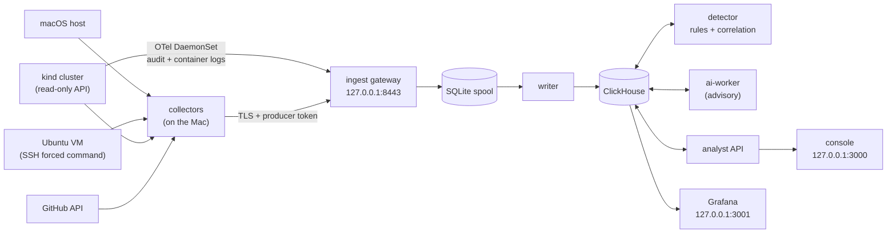

# ExtorQ

ExtorQ is a small, production-minded security telemetry, detection,
correlation and investigation platform (a mini SIEM) for a lab on one Apple
Silicon Mac. It collects real telemetry from four asset classes (the macOS host,
an Ubuntu VM, a kind Kubernetes cluster and a GitHub lab repository), breaks
each host and node down into the **services** it runs, stores everything in
ClickHouse, runs versioned SQL detections, builds evidence-traceable
investigations. Jev can optionally provide advisory triage.

Principle: **deterministic collection and detection establish the evidence; AI
assists interpretation and is never authoritative.** Unknown values stay
unknown, and services that ExtorQ cannot monitor are shown as unmonitored
instead of being hidden.

> The current release candidate is tracked in [release verification](docs/team/status/release-verification.md).
> Earlier lab results are recorded separately in [testing](docs/testing.md).

## Architecture at a glance



* **Collection:** native macOS collector, agentless SSH collection from the VM
  through a read-only dispatcher, an OTel Collector DaemonSet plus a read-only
  inventory collector for Kubernetes, GitHub REST polling, and Trivy, Gitleaks
  and Semgrep scanners in pinned containers.
* **Ingestion:** HTTPS gateway with per-producer tokens and per-record
  authorisation, validation against versioned contracts, secret redaction,
  quarantine, and a durable spool that is committed before any `202`.
* **Detection:** 22 versioned SQL rules with positive and negative fixtures. The
  scheduler revisits overlapping event windows for late arrivals. The
  [detection catalog](docs/detection-catalog.md) defines evidence and blind spots.
* **Services:** Asset -> Service -> Instance hierarchy with evidence-based
  discovery, explicit port-attribution confidence and coverage states
  (discovered, supported, monitored, unmonitored); adapters for SSH, nginx,
  Apache (parsers only), the lab web app, systemd and auditd on Linux, sshd and
  Screen Sharing on macOS, and Kubernetes audit, container logs and events; FTP,
  PostgreSQL, MySQL, DNS and Redis are planned extension points.
* **Investigation:** InvestigationContexts with direct, candidate and
  unestablished relationships; correlation never claims causation.
* **AI:** Optional, budgeted Jev triage consumes sanitized context and stores
  advisory assessments.

Details: [architecture](docs/architecture.md), [threat model](docs/threat-model.md),
[security and privilege audit](docs/security.md), [ADRs](docs/adr/README.md).

## Quick start (Apple Silicon)

Prerequisites: Docker Desktop, `uv`, `kind`, `kubectl`, `qemu-system-aarch64`
(with edk2 firmware in `/opt/homebrew/share/qemu`), `pnpm`, `openssl`. The
`Makefile` is the entry point (`make help` lists every target); each target
runs the documented script shown in [docs/deployment.md](docs/deployment.md).

```sh
make bootstrap      # secrets, local CA, producer registry in var/ (0600, never printed); uv sync
make up             # core stack: ClickHouse, migrations, gateway (127.0.0.1:8443), writer
make up-full        # + detector, ai-worker, API (127.0.0.1:8000), Grafana (127.0.0.1:3001), console (3000); AI off
make vm-up          # Ubuntu 24.04 lab VM on QEMU/HVF (SSH 127.0.0.1:2222, HTTP 127.0.0.1:8088)
make kind-up        # kind cluster "extorq-lab" with audit logging, PSA and the OTel DaemonSet
make collectors-start   # every enabled host collector in the background (collectors-status, collectors-stop)
make demo-check     # read-only readiness report: services, gateway, API, console, Grafana, collectors

make scan          # collect posture findings for configured targets
```

See [deployment](docs/deployment.md) for the optional Jev configuration and
[testing](docs/testing.md) for controlled validation on explicitly authorized assets.

Then open the console at http://127.0.0.1:3000 (accounts `analyst` and
`viewer`; their passwords are the files `var/secrets/analyst_password` and
`var/secrets/viewer_password`, never pasted anywhere else) and Grafana at
http://127.0.0.1:3001 (user `admin`, password file
`var/secrets/grafana_admin_password`). The 15-minute demonstration, its
pre-flight checklist and fallbacks are in [docs/demo-runbook.md](docs/demo-runbook.md).

## Repository map

| Path | Contents |
|---|---|
| `backend/src/extorq/` | contracts, gateway, spool and writer, detection, AI, analyst API |
| `collectors/src/extorq_collectors/` | collector SDK, service-discovery interface, macOS, Linux, Kubernetes and GitHub collectors |
| `scanners/` | Trivy, Gitleaks and Semgrep integration |
| `rules/` | detection rules (YAML + SQL) and fixtures |
| `detection_tests/` | controlled validation, evidence verification and local reports |
| `infra/` | ClickHouse, VM, kind and Grafana configuration |
| `frontend/` | Next.js security console |
| `lab/` | deliberately attackable lab targets (not ExtorQ code) |
| `tests/` | unit, integration, rules, AI and security tests |
| `docs/` | architecture, security, operations and team documents |
| `var/` | runtime state and secrets: gitignored, never commit |

## Documentation

* [Architecture](docs/architecture.md) (service model in section 5)
* [Threat model](docs/threat-model.md) and [security and privilege audit](docs/security.md)
* [Deployment](docs/deployment.md), [operations](docs/operations.md), [testing](docs/testing.md), [recovery](docs/recovery.md)
* [Telemetry sources](docs/telemetry-sources.md), [known limitations](docs/known-limitations.md)
* [Demo runbook](docs/demo-runbook.md), [ADRs](docs/adr/README.md)
* Engineering guide for contributors and agents: [AGENTS.md](AGENTS.md)
* Build plan, ownership and interfaces: [docs/team/PLAN.md](docs/team/PLAN.md)

## Security

ExtorQ binds every port to `127.0.0.1`, keeps ClickHouse on an internal network,
gives every service its own least-privilege identity and treats all telemetry
as attacker-controlled. Never commit or print anything under `var/` or `.env`.
Report security issues to the repository owner privately.
