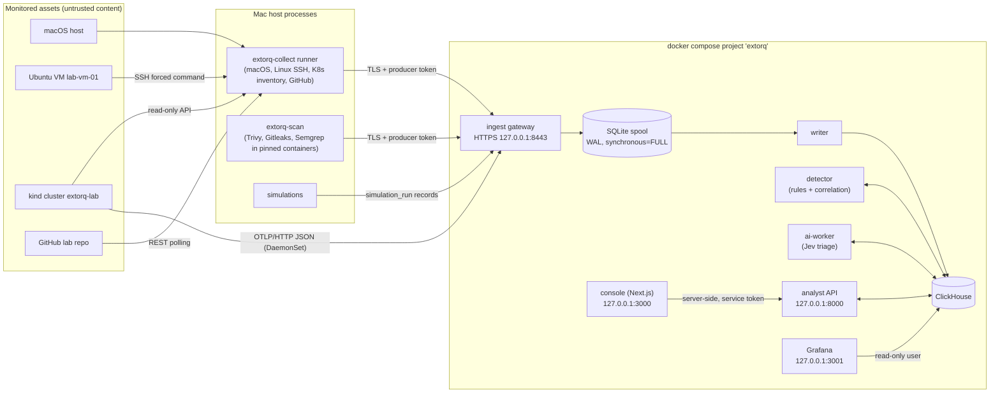
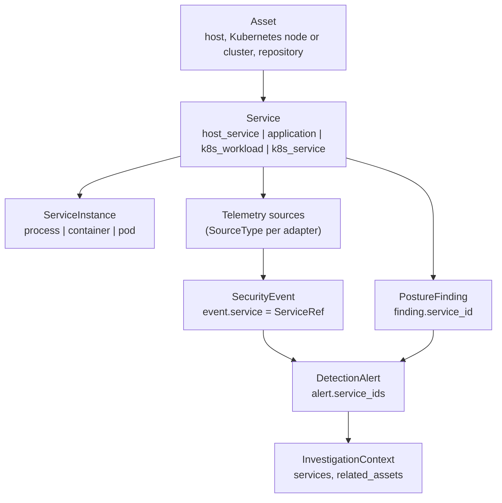

# ExtorQ Architecture

Owner: agent F (documentation). Living document; baseline 2026-11-21, updated
for contract schema **1.1** (service-aware monitoring, PLAN section 10) and
re-checked on 2026-11-22 (build session 3).
Authoritative interfaces: [`docs/team/PLAN.md`](team/PLAN.md) and the Pydantic
contracts in [`backend/src/extorq/contracts/`](../backend/src/extorq/contracts/).

Status labels used below:

* **implemented**: the code or configuration exists in the repository and F has read it;
* **in progress**: the owner is building it in the current build session;
* **planned**: designed (PLAN or contracts) but not present yet.

Never read a label as a test result. Test results live in
[`docs/testing.md`](testing.md) and in each agent's `docs/team/status/<id>.md`.

## 1. What ExtorQ is

ExtorQ is a single-operator security telemetry, detection, correlation and
investigation platform (a small SIEM) for a lab on one Apple Silicon Mac. It
monitors four asset classes:

| Asset class | Asset id | How telemetry is obtained |
|---|---|---|
| macOS host (the Mac itself) | `macos:workstation-01` | native collector running as the operator user (unified log, launchd, inventory, posture) |
| Ubuntu 24.04 VM under QEMU/HVF | `linux:lab-vm-01` | agentless SSH pull through a forced-command dispatcher |
| kind cluster `extorq-lab` | `k8s:extorq-lab`, nodes `k8s:extorq-lab/node/<name>` | OTel Collector DaemonSet (audit + container logs) and a read-only inventory collector |
| GitHub lab repository | `github:<owner>/extorq-lab` (lab: private `Exigent07/extorq-lab`) | REST API polling; the lab uses the approved gh CLI token fallback, a fine-grained read-only token is preferred ([known limitations](known-limitations.md) C8) |

Design principle: **deterministic collection and detection establish the
evidence; AI assists interpretation and is never authoritative.** Unknown values
stay unknown (`None`/`NULL`); nothing is invented to fill a dashboard.

## 2. Component map

| Component | Code | Owner | Status |
|---|---|---|---|
| Contracts, catalog, identities | `backend/src/extorq/contracts/` | lead | implemented (schema 1.1) |
| ClickHouse schema | `infra/clickhouse/migrations/0001..0006` | lead (0001, 0004, 0006), A (0002), C3 (0003, 0005) | implemented, 0001-0006 applied on the running stack |
| Bootstrap (secrets, CA, producers) | `scripts/bootstrap.py` | A | implemented |
| Ingest gateway | `backend/src/extorq/ingest/` | A (B2 for `otlp_k8s.py`) | implemented (schema 1.1 record kinds, service identity binding, 90-day event age limit) |
| Spool and writer | `backend/src/extorq/pipeline/` | A | implemented (incl. service rows) |
| Collector SDK and runner | `collectors/src/extorq_collectors/sdk/`, `cli.py` | A | implemented (runner, outbox, sender, `extorq-collect` CLI) |
| Shared service-discovery interface | `collectors/src/extorq_collectors/services/` | lead, then B1 | implemented (interface + planned adapters) |
| Linux VM, dispatcher, collector | `infra/vm/`, `collectors/src/extorq_collectors/linux/` | B1 | implemented (VM, dispatcher, parsers, collector, discovery, adapters); live verification by B1 |
| Kubernetes lab, OTel, normaliser, inventory | `infra/kind/`, `backend/src/extorq/ingest/otlp_k8s.py`, `collectors/src/extorq_collectors/kubernetes/` | B2 | implemented (cluster, audit policy, RBAC, DaemonSet, normaliser, inventory collector, hierarchy, K8S-001/K8S-002 simulations) |
| macOS collector | `collectors/src/extorq_collectors/macos/` | B3 | implemented (parsers, collector, discovery, sshd and Screen Sharing adapters) |
| GitHub collector | `collectors/src/extorq_collectors/github/` | C1 | implemented (client, poller, workflow analyser, posture) |
| Detection, rules, correlation | `backend/src/extorq/detection/`, `backend/src/extorq/correlation/`, `rules/` | C2 | implemented (engine with late-data catch-up, SQL guard, VM-001, VM-002, K8S-001, K8S-002, GH-001, experimental HTTP-001, APP-001, MAC-001, CORR-002, context builder, scenario verification tooling) |
| Scanners | `scanners/` | C3 | implemented (normalisers, runner, lifecycle views 0003 and 0005) |
| AI (Jev, Gemini) | `backend/src/extorq/ai/` | E | implemented (providers, sanitiser, budgets, worker) |
| Analyst API, Grafana | `backend/src/extorq/api/`, `infra/grafana/` | D1 | implemented (API incl. service endpoints; Grafana image, provisioning, dashboards) |
| Security console | `frontend/` | D2 | implemented views: overview, assets, services, detections, investigations, health; `frontend/Dockerfile` present (compose container not yet verified end to end) |

## 3. Data flow

1. **Collect.** Collectors run on the Mac (`extorq-collect run`). Each collector
   reads its source, normalises records into the contracts and appends them to
   a per-collector SQLite outbox together with its checkpoints in one
   transaction (`collectors/src/extorq_collectors/sdk/state.py`). A sender
   drains the outbox to the gateway with bounded, jittered retries; a gateway
   outage only delays delivery.
2. **Ingest.** The gateway (`backend/src/extorq/ingest/`) authenticates the
   producer token (SHA-256 digest compared against every registered producer),
   validates each record against the contracts and the event catalog,
   authorises it (record kind, asset pattern, source type), checks event times,
   redacts secrets in free-text fields, deduplicates, quarantines bad records
   (`ingest_quarantine`) and commits accepted records to the spool **before**
   answering `202`. Unauthorised batches get `403` and an `ingest_audit` row.
3. **Store.** The writer drains the spool into ClickHouse as `extorq_ingest`
   with at-least-once semantics: deterministic identities plus
   `ReplacingMergeTree` collapse duplicates, and poison records are bisected out
   into a dead-letter table (`backend/src/extorq/pipeline/writer.py`).
4. **Detect.** The detector runs versioned SQL rules (`rules/**`) as the
   read-only `extorq_rules_ro` identity over overlapping windows, derives alert
   identities deterministically, merges late evidence into existing alerts and
   records every evaluation in `rule_runs` (`backend/src/extorq/detection/`).
5. **Correlate.** For new or updated alerts the detector builds an
   `InvestigationContext` (evidence, timeline, relationships with explicit
   confidence, coverage and gaps) whose canonical hash (`input_hash`) pins
   exactly what any later AI assessment saw (`backend/src/extorq/correlation/`).
6. **Enrich (optional).** The ai-worker asks Jev for advisory triage; the API
   asks Gemini for a summary only when an analyst requests it. Both receive a
   sanitised allow-list projection of the context and write only
   `ai_assessments` (`backend/src/extorq/ai/`).
7. **Present.** The analyst API serves the console's server side; Grafana reads
   analytics tables as a read-only user without access to raw payloads.

Health is first-class telemetry: every collector cycle emits a
`CollectorHealth` record, pipeline components emit `PipelineHealth`, and
collectors emit `extorq.collector.gap_detected` events when their source lost
data (rotated past an offset, invalidated cursor, truncated history).

## 4. Contracts, identities and storage

* Every cross-boundary record is one of the contract models
  (`IngestRecord` kinds: `event`, `asset`, `inventory_item`, `finding`,
  `scan_run`, `collector_health`, `simulation_run`, and in 1.1 `service`,
  `service_instance`). Models forbid extra fields, require timezone-aware UTC
  timestamps and reject NaN/Infinity.
* The event catalog (`contracts/catalog.py`) fixes, per event type, the
  category and the allowed source types; the gateway quarantines anything else.
* Identities are deterministic hashes (`contracts/identity.py`): `event_id`,
  `finding_id`, `alert_id(rule_id, group_key, bucket)`, `context_id`,
  `assessment_id`, `scope_hash`, and in 1.1 `service_id` and `instance_id`.
  Re-sending the same record produces the same id, which is what makes
  at-least-once delivery safe (ADR 0008).
* ClickHouse tables are append-only `MergeTree` (events) or
  `ReplacingMergeTree` (latest-state tables), read through `v_*` views that use
  `FINAL`/`argMax`. Queries count `uniqExact(event_id)`. Column names in the
  migrations are the contract for rule SQL, API queries and dashboards.

## 5. Service model (schema 1.1)

A host or Kubernetes node runs many services. ExtorQ models them explicitly so
that telemetry, findings and alerts can be attributed to the service that
produced them, and so that the console can show honestly which services are
monitored and which are not. Lead-owned artefacts:
[`contracts/service.py`](../backend/src/extorq/contracts/service.py),
[`identity.py`](../backend/src/extorq/contracts/identity.py) (`service_id`,
`instance_id`), [`0004_services.sql`](../infra/clickhouse/migrations/0004_services.sql)
and the collector-side interface
[`collectors/src/extorq_collectors/services/`](../collectors/src/extorq_collectors/services/).
Design decision: [ADR 0010](adr/0010-service-model-and-adapter-registry.md).

### 5.1 Hierarchy

| Level | Contract | Natural key | Identity |
|---|---|---|---|
| Asset | `Asset` | `asset_id` (`linux:lab-vm-01`, `k8s:extorq-lab/node/<name>`) | the asset id itself |
| Service | `Service` | `service_key`: systemd unit name, launchd label, configured application name, `<namespace>/<kind>/<name>` (workload), `<namespace>/<name>` (Kubernetes Service) | `service_id(asset_id, service_kind, service_key)` |
| Instance | `ServiceInstance` | `instance_key`: pid plus start time (process), container id (container), pod uid (Pod) | `instance_id(service_id, instance_kind, instance_key)` |
| Event attribution | `SecurityEvent.service` (`ServiceRef`) | set only when the adapter can genuinely attribute the record | refers to `service_id`, optional `instance_id` and `adapter_id` |
| Finding attribution | `PostureFinding.service_id` | e.g. an sshd configuration finding attributed to the ssh service | `service_id` |
| Alert attribution | `DetectionAlert.service_ids` | every service whose telemetry is evidence (may be several) | list of `service_id` |

Identity properties: the same unit on the same asset always gets the same
`service_id`; a restarted process gets a new `instance_id` (its start time
changes); a Pod keeps its instance id for its lifetime (uid). Services that
disappear are kept as tombstones (`present = false`) rather than deleted, so
historic events stay resolvable.

### 5.2 Service kinds

| `ServiceKind` | Meaning | Examples |
|---|---|---|
| `host_service` | operating-system managed service | `ssh.service`, `nginx.service`, a launchd job |
| `application` | an application identified by configuration or process evidence without its own service-manager unit | a web app behind a reverse proxy |
| `k8s_workload` | a Kubernetes workload controller (Deployment, DaemonSet, StatefulSet, Job, CronJob) or a bare Pod | `extorq-apps/Deployment/lab-portal` |
| `k8s_service` | a **logical Kubernetes Service object** (virtual IP and ports) | `extorq-apps/lab-portal` |

A Kubernetes `Service` resource is never modelled as a host operating-system
service: they are different kinds with different natural keys, so they can
never share a `service_id`.

### 5.3 Discovery

Discovery turns evidence into `ServiceCandidate` objects
(`services/base.py`). A candidate without evidence cannot be constructed
(`ValueError`), and `Service.discovered_via` is never empty.

| Evidence (`DiscoveryEvidence`) | Linux VM (B1) | macOS host (B3) | Kubernetes (B2) |
|---|---|---|---|
| `systemd_unit` | unit files (`/etc`, `/run`, `/usr/lib` ...) and `*.wants` links from the dispatcher's `inventory` command | n/a | n/a |
| `launchd_job` | n/a | launchd plists | n/a |
| `process` | `/proc/<pid>/cgroup` places a process in a systemd unit (kernel attested, world-readable); comm, uid, start time | `ps` (pid, user, start time, executable path) | n/a |
| `listening_socket` | `ss -H -t -u -l -p -n -e --cgroup`: the kernel reports the cgroup (unit) of the socket's creator without root | `netstat` (last pid) or `lsof` (own processes only, owner pid) | n/a |
| `configuration` | known config such as sshd `Port`, nginx `listen` | known config | n/a |
| `k8s_api` | n/a | n/a | workloads, Pods, Services from the read-only inventory identity |
| `adapter_config` | an adapter configured explicitly for a service | same | same |

Honesty rules (PLAN 10.1, enforced by the contract and the shared interface):

1. **A process is not a network service.** `ServiceCandidate.is_network_service`
   is `True` only when evidence shows a listener, `None` when unknown, never
   assumed.
2. **Ports are attributed with stated confidence** (`ServiceEndpoint.attribution`):
   `confirmed` only when the socket owner (pid/process) was observed and belongs
   to the service's instance; `inferred` from configuration or a well-known
   port; `unknown` when the owner cannot be determined with the privileges the
   collector has. `ServiceAdapter.matches()` never uses ports: a well-known port
   alone does not identify a product.
3. **Collector privileges bound what can be confirmed.** The VM collector
   account is unprivileged (groups `adm`, `systemd-journal`): `ss -p` names
   owners only for its own sockets, but `ss -e --cgroup` reports each socket's
   cgroup from the kernel, so a socket created inside `nginx.service` is
   `confirmed` for that unit without root (B1, `linux/discovery.py`). Listeners
   whose cgroup maps to no service stay unattributed at asset level. User
   sessions (`user.slice`) never become host services. On macOS, attribution is
   `confirmed` only when `netstat`/`lsof` report the owning pid of the
   service's process, `inferred` for sockets launchd holds for socket-activated
   jobs, otherwise unattributed (B3, `macos/services.py`).
4. **Forwarded ports belong to the forwarder.** On the Mac, `127.0.0.1:2222`
   and `127.0.0.1:8088` are owned by `qemu-system-aarch64` (they forward to the
   VM's sshd and nginx) and the compose ports by Docker Desktop's backend. The
   macOS discovery attributes them to the owning process, never to sshd or
   nginx; the services themselves belong to the VM or a container (see
   [known limitations](known-limitations.md) S5).
5. **Exposure is derived from the bind address** (`exposure_of`): loopback,
   private (RFC 1918, ULA, link-local), any (`0.0.0.0`, `::`), otherwise
   unknown.
6. **Versions only when observed** (package inventory or similar), never guessed
   from a product name.

### 5.4 Coverage: discovered, supported, actively monitored

Two independent fields describe coverage:

* `adapter_support` (can ExtorQ collect this service's telemetry?):
  `implemented`, `planned` (extension point only, no telemetry), `none`;
* `monitoring_status` (is it collecting right now?): `monitored`, `degraded`,
  `unmonitored`.

`classify_coverage()` in `services/base.py` decides deterministically:

| Condition (checked in order) | `adapter_support` | `monitoring_status` | `coverage_note` |
|---|---|---|---|
| no adapter matches | `none` | `unmonitored` | no adapter for this service type |
| matching adapter is planned | `planned` | `unmonitored` | planned adapter: discovered only, no telemetry collected |
| implemented, not enabled | `implemented` | `unmonitored` | adapter available but not enabled |
| implemented, source failing | `implemented` | `degraded` | telemetry source failing |
| implemented, no telemetry yet | `implemented` | `degraded` | adapter enabled; no telemetry yet |
| implemented, last telemetry older than the stale limit | `implemented` | `degraded` | adapter enabled; telemetry stale |
| otherwise | `implemented` | `monitored` | telemetry fresh |

The stages named in the brief map to these fields as follows: **discovered** =
a `Service` row exists; **supported** = `adapter_support = implemented`;
**actively monitored** = `monitoring_status = monitored`; **unmonitored** =
everything else, always shown with its `coverage_note`, never hidden.

### 5.5 Service telemetry adapters

`ServiceAdapter` (`services/base.py`) is the common interface for
service-specific collectors. An adapter declares, as class attributes, how it
recognises a service (`products`, `unit_patterns` (fnmatch), `executables`
(basenames), `well_known_ports` for inferred attribution only), its
`source_types`, a `description`, what it `collects` and what it
`never_collects`. Implemented adapters override `accepts(raw)` and
`parse(raw, ctx) -> list[SecurityEvent]`; the events carry `ctx.service`
(a `ServiceRef`). A planned adapter keeps the defaults: `accepts()` returns
`False` and `parse()` raises `NotImplementedError`, so it can never emit
telemetry.

The registry (`services/registry.py`) is keyed by `adapter_id`. An
implemented registration replaces a planned one with the same id, and a planned
one never replaces an implemented one; `match_adapter()` prefers implemented
adapters, then planned, then none (ties broken by `adapter_id`).

| Adapter | Support | Source types | Collects (summary) | Never collects (summary) | Code |
|---|---|---|---|---|---|
| `ssh` | implemented | `linux.journald` | failed/accepted authentication (method, user, source, key fingerprint), invalid users, pre-auth disconnects, MaxAuthTries, PAM failures and sessions | passwords or keyboard-interactive responses, private keys, session contents | `linux/adapters/ssh.py` (B1) |
| `nginx` | implemented | `linux.nginx` | access: method, path **without query**, status, bytes, duration, user agent, client, `$request_id`; error-log class and request path without query | query strings, bodies, Authorization/Cookie headers, Referer queries | `linux/adapters/nginx.py` (B1) |
| `apache` | implemented, **not deployed in the lab** | `linux.apache` | Common/Combined access log and error log, paths without query | query strings, bodies, Referer, Authorization or passwords | `linux/adapters/apache.py` (B1) |
| `webapp-json` | implemented | `linux.app` | lab-portal (`lab-portal.log.v1`) login successes/failures, authorization denials, optional access records | passwords or session tokens, bodies, query strings | `linux/adapters/webapp_json.py` (B1) |
| `systemd` | implemented | `linux.journald`, `linux.inventory` | unit lifecycle, daemon reloads, unit files created/modified/deleted (sha256, ExecStart), enablement, drop-ins | `Environment=`/`EnvironmentFile=` values, unit contents beyond an allow-list | `linux/adapters/systemd.py` (B1) |
| `auditd` | implemented | `linux.auditd` | writes to watched paths, root execve on behalf of users (redacted command line), audit rule changes | file contents, records outside ExtorQ rule keys | `linux/adapters/auditd.py` (B1) |
| `macos-sshd` | implemented (when Remote Login is enabled) | `macos.unified_log` | sshd authentication failures/successes, invalid users | passwords, key material, session contents, private log arguments | `macos/adapters.py` (B3) |
| `macos-screensharing` | implemented | `macos.unified_log` | Screen Sharing authentication results with viewer address | screen contents, keystrokes, clipboard, passwords | `macos/adapters.py` (B3) |
| `k8s-audit` | implemented | `k8s.audit` | who did what to which object, response code, PSA/authorization decisions, bounded request summary | Secret/ConfigMap/token bodies (Metadata only), full bodies | `kubernetes/adapters.py` (B2) |
| `k8s-container-log` | implemented | `k8s.container_log` | container stdout/stderr (bounded, redacted) with Pod uid, container id, namespace, node, workload | collector's own logs, in-container process/file/network activity | `kubernetes/adapters.py` (B2) |
| `k8s-events` | implemented | `k8s.events` | Event reason/type/count/message per object | events older than the API server's event TTL | `kubernetes/adapters.py` (B2) |
| `ftp` | **planned** | none | planned: auth success/failure, sessions, client address | file contents, transfer payloads, credentials, directory listings | `services/planned.py` |
| `postgresql` | **planned** | none | planned: connection authorisation failures, role/privilege changes | query text or parameters, result sets, credentials | `services/planned.py` |
| `mysql` | **planned** | none | planned: authentication failures, account/grant changes | query text or parameters, result sets, credentials | `services/planned.py` |
| `dns` | **planned** | none | planned: zone transfer attempts, refused queries, reloads | full client query logs by default, TSIG keys | `services/planned.py` |
| `redis` | **planned** | none | planned: AUTH failures, CONFIG/ACL changes, protected-mode exposure | keys or values, command arguments, credentials | `services/planned.py` |

Summaries are taken from each adapter's `collects`/`never_collects`
declarations (code paths relative to `collectors/src/extorq_collectors/`).
`tests/security/test_security_service_adapters.py` enforces the declarations
and per-category minimums for every registered adapter, and
`tests/security/test_security_adapter_canaries.py` checks that the HTTP
adapters strip query strings and Referer values from emitted events. How to add or implement an adapter:
[AGENTS.md](../AGENTS.md#72-add-a-service-adapter).

### 5.6 Data minimisation

* Service records carry configuration **references** (paths in `config_refs`),
  never configuration contents.
* Adapters never collect FTP file contents, application credentials, HTTP
  `Authorization` headers or cookies, or database query text, and declare this
  in `never_collects`.
* Sources are configured to log less where ExtorQ controls them: the lab nginx
  logs `$uri` (no query string) and no request headers except the user agent
  (`infra/vm/files/nginx/extorq-lab.conf`); the lab portal never logs passwords
  (`lab/apps/lab-portal/`).
* The gateway still redacts secret patterns in free-text fields of every
  record kind, including `service` and `service_instance`, as defence in depth
  (`backend/src/extorq/ingest/processing.py`; verified by
  `tests/security/test_security_ingest_redaction.py`). Pattern redaction is not a substitute for not
  collecting: see [threat model T21](threat-model.md#t21-service-adapters-collecting-sensitive-data-i).

### 5.7 Kubernetes levels

| Kubernetes concept | ExtorQ model |
|---|---|
| Cluster `extorq-lab` | asset `k8s:extorq-lab` (`kubernetes_cluster`) |
| Node (in kind, a Docker container acting as a virtual node) | asset `k8s:extorq-lab/node/<name>` (`kubernetes_node`) |
| Workload (Deployment, DaemonSet, StatefulSet, Job, CronJob, bare Pod) | `Service` with `service_kind = k8s_workload`, key `<namespace>/<kind>/<name>` |
| Kubernetes `Service` object | `Service` with `service_kind = k8s_service`, key `<namespace>/<name>`, endpoints from its ports |
| Pod | `ServiceInstance` with `instance_kind = pod`, key = Pod uid, `asset_id` = the node asset |
| Container | `ServiceInstance` with `instance_kind = container`, key = container id, `parent_instance_id` = its Pod instance |

Container logs are enriched with Pod uid, container id, namespace, node and
workload (`KubernetesInfo.{pod_uid, container_id, namespace, node_name,
workload_kind, workload_name}`) and, where the workload is known, a `ServiceRef`
to the workload service (B2, `backend/src/extorq/ingest/otlp_k8s.py`, in
progress). Kubernetes API audit events stay cluster-level events
(`k8s.api.request`); they are attributed to a workload only when the audit
record itself names it.

### 5.8 Storage

`0004_services.sql` (applied live) adds:

* `extorq.services` (`ReplacingMergeTree(last_seen)`, ordered by
  `(asset_id, service_id)`, 30-day TTL) and `extorq.service_instances`
  (`ReplacingMergeTree(observed_at)`, ordered by `(service_id, instance_id)`,
  30-day TTL); read them through `v_services` and
  `v_service_instances_current` (`FINAL`, present instances only);
* `events.{service_id, service_name, service_instance_id, adapter_id,
  k8s_container_id}` with a bloom-filter index on `service_id`;
  `finding_observations.service_id`; `alerts.service_ids`;
* grants: `extorq_ingest` inserts; detect, rules_ro, api_ro and grafana read.
  Grafana's column-level grant on `events` gains only the new non-sensitive
  columns (still no `raw`/`payload`).

### 5.9 Correlation across services and assets

The context builder records relationships with explicit bases
(`RelationshipBasis`, `contracts/context.py`) and confidence types
(`direct`, `candidate`, `unestablished`). Schema 1.1 adds `same_service`,
`same_service_instance`, `cross_service_same_asset` and `cross_asset`.
Rules (PLAN 10.1 rule 5):

* identities, timestamps, network context and confidence are preserved on every
  relationship;
* temporal proximity alone is never causation: rule CORR-002
  (`rules/correlation/CORR-002.*`, status experimental) reports HTTP probing,
  then SSH authentication failures, then an unexpected systemd change on one
  host within 30 minutes as ordered co-occurrence across three services, and
  its description states that it establishes neither causation nor a single
  actor;
* cross-asset links need identity evidence (shared request id, Pod uid, commit
  sha). A shared source IP is weak evidence in this lab because every
  connection from the Mac reaches the VM as the QEMU NAT address `10.0.2.2`
  (`shared_nat_source_ip` is recorded as unestablished).

### 5.10 Drill-down in the UI

Navigation (D1 API, D2 console; implemented):
**Asset -> Services / Workloads -> Telemetry -> Findings -> Alerts -> Investigation.**
API: `GET /api/v1/assets/{id}/services`, `GET /api/v1/services`,
`GET /api/v1/services/{service_id}` (instances, endpoints, coverage, events,
findings, alerts), and `service_id` filters on events, findings and alerts.
Unsupported and unmonitored services are listed with their `coverage_note` and
the API's effective coverage reasons.

### 5.11 Implementation status (PLAN 10.2)

| Agent | Work | Status (2026-11-22) |
|---|---|---|
| lead | contracts 1.1, migrations 0004 and 0006, shared interface, planned adapters | implemented, applied |
| A | rows mapping, producer kinds, gateway 1.1, redaction of service kinds, SDK support, identity binding | implemented (gateway quarantines `identity_mismatch`, F-19 gateway part) |
| B1 | Linux discovery (units, cgroups, sockets, config), ssh/nginx/apache/webapp-json/systemd/auditd adapters, service records | implemented; process-argument minimisation open (F-17) |
| B2 | node assets, workload and Kubernetes Service services, Pod/container instances, log enrichment, k8s adapters | implemented |
| B3 | macOS discovery (launchd, processes, listeners), sshd and Screen Sharing adapters | implemented |
| C2 | service-aware correlation, `alerts.service_ids`, CORR-002 | implemented (`backend/src/extorq/correlation/`, `rules/correlation/CORR-002.*`) |
| C3 | `0005_findings_services.sql`, finding attribution | implemented (`infra/clickhouse/migrations/0005_findings_services.sql`, `scanners/src/extorq_scanners/services.py`) |
| D1 | service endpoints | implemented; asset-scoped instance and event joins open (F-19 API part) |
| D2 | drill-down views | implemented (assets, services, detections, investigations) |
| E | service summaries in the AI projection (names, kinds, coverage only) | implemented (`backend/src/extorq/ai/projection.py`) |
| F | architecture, threat model, AGENTS.md, known limitations, security tests | this document; `tests/security/` |

Implementation statuses come from code read by F; end-to-end verification of
each component is recorded by its owner and in [testing.md](testing.md).

## 6. Detection and correlation

* Rules are YAML metadata plus one SQL file each (`rules/<platform>/<ID>.{yaml,sql}`)
  with positive and negative JSONL fixtures under `rules/<platform>/tests/<ID>/`.
* `detection/sqlguard.py` validates rule SQL at load time (single
  `SELECT`/`WITH`, allow-listed tables, no table functions, no dangerous scalar
  functions, server-side `{name:Type}` parameters only); the authoritative
  boundary is the `extorq_rules_ro` identity with `readonly=1`.
* Mandatory rules: VM-001 (SSH authentication failures burst), VM-002 (systemd
  persistence), K8S-001 (privileged Pod denied by Pod Security Admission),
  K8S-002 (risky RBAC change), GH-001 (workflow permission escalation). Their
  semantics are fixed in PLAN 5.3; all five have alerted on genuine scenario
  telemetry ([testing.md section 4](testing.md#4-scenario-verification-genuine-telemetry)).
* Experimental rules: HTTP-001 (web probing), APP-001 (failed application
  logins), MAC-001 (launchd persistence) and CORR-002 (ordered probing, SSH
  failures and systemd persistence on one host; confidence never above medium,
  never causation). Catalog: [`docs/detection-catalog.md`](detection-catalog.md).
* Late-arriving telemetry (for example a collector backfill) is re-evaluated by
  a catch-up pass without duplicating alerts.
* Only the detector writes alerts (`extorq_detect`); AI and analysts cannot.

## 7. AI boundary

* Providers are disabled unless enabled by flag and key; daily caps are
  enforced; every call has a timeout; failures never block detection
  (`backend/src/extorq/ai/settings.py`, `budget.py`, `worker.py`).
* Input is an allow-listed projection of the InvestigationContext, cleaned and
  redacted (`ai/projection.py`, `ai/sanitize.py`); output is cleaned again and
  every cited evidence id is checked against the bundle.
* Output is stored only in `ai_assessments`, labelled advisory, and never
  changes severity, state or alerts (ADR 0007).

## 8. Presentation

* Analyst API (`backend/src/extorq/api/`): FastAPI, `Authorization: Bearer
  <service token>` plus `X-ExtorQ-User`/`X-ExtorQ-Role`; mutations need
  `analyst`; queries are static SQL with server-side parameters as
  `extorq_api_ro`; writes go through `extorq_api_writer`.
* Console (`frontend/`): Next.js server components call the API server-side;
  the browser holds only an HttpOnly, `SameSite=Strict` signed session cookie;
  CSP with a per-request nonce; telemetry is rendered as text.
* Grafana: provisioned ClickHouse data source as `extorq_grafana` (no access to
  `events.raw`, `events.payload`, quarantine excerpts).

## 9. Runtime topology

Compose networks: `data` (`internal: true`, no egress: ClickHouse, writer,
detector, migrate) and `edge` (gateway, API, console, Grafana, ai-worker). The
gateway is on `edge` only; its only link to the data plane is the spool
volume. All published ports bind `127.0.0.1`. Details, identities and port
inventory: [docs/security.md](security.md); decision record:
[ADR 0009](adr/0009-compose-networks-and-loopback-exposure.md).

## 10. Related documents

* [Threat model](threat-model.md) and [security and privilege audit](security.md)
* [Deployment](deployment.md), [operations](operations.md), [testing](testing.md)
* [Telemetry sources](telemetry-sources.md), [known limitations](known-limitations.md)
* Component documents by their owners: [data model](data-model.md),
  [data flow](data-flow.md), [collector SDK](collectors.md),
  [AI integrations](ai-integrations.md), [analyst API](api/README.md)
* [Demo runbook](demo-runbook.md), [ADRs](adr/)
* Team plan and interfaces: [docs/team/PLAN.md](team/PLAN.md)
