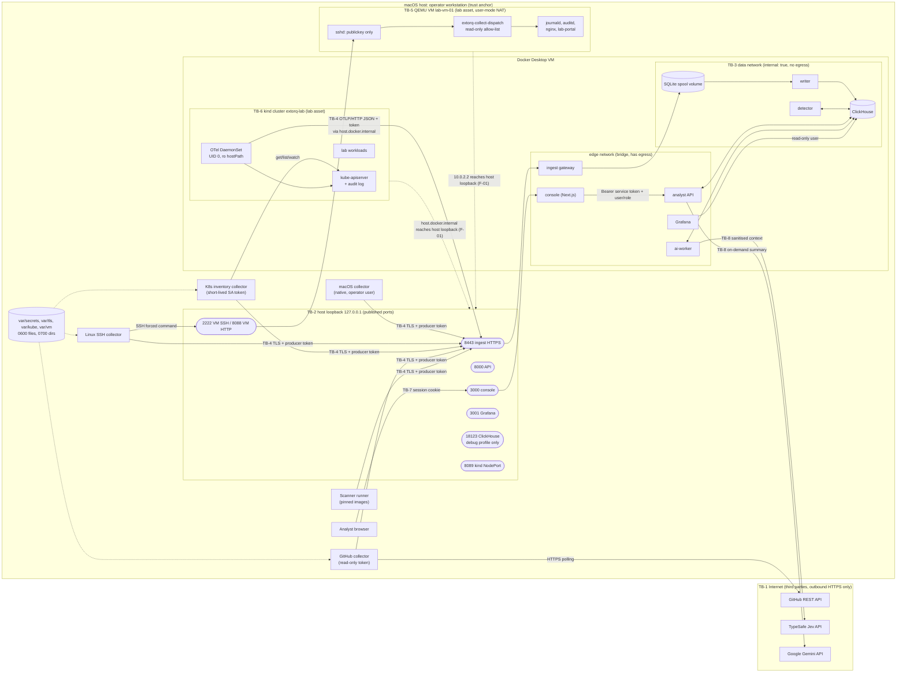

# ExtorQ Threat Model

Owner: agent F (security assurance). Status: **living document**, baseline of
2026-11-21. It describes the system as built at that date. Each mitigation is
marked:

* **implemented**: F has read the code or configuration that does it (file given);
* **verified**: implemented, and F ran a check that exercised it (command in
  `docs/team/status/F.md` or a test under `tests/security/`);
* **partial**: some of it exists, the rest is still being built;
* **planned**: designed in `docs/team/PLAN.md` but not yet present.

Planned items are collected for the lead in [section 8](#8-open-items-for-the-lead).
Review findings referenced as `F-nn` are tracked in `docs/team/status/F.md`.

## 1. Scope and assumptions

ExtorQ is a single-operator lab SIEM running on one Apple Silicon Mac. It
collects telemetry from four asset classes (the Mac itself, an Ubuntu VM, a kind
Kubernetes cluster, a GitHub repository), stores it in ClickHouse, runs
versioned SQL detections, builds evidence bundles and optionally asks two AI
providers for advisory output.

Assumptions:

1. **The Mac and its operator account are the trust anchor.** Everything in
   `var/` (secrets, TLS keys, kubeconfigs, VM keys) is protected only by file
   permissions (0600/0700) and the operator's login. A compromise of the
   operator account is out of scope: it yields every credential.
2. **Lab assets are untrusted by design.** The VM, the kind workloads and the
   lab GitHub repository are monitored targets; simulations attack them on
   purpose. Their telemetry is attacker-influenced data.
3. **Docker Desktop and QEMU are trusted** to enforce the network isolation
   they document (internal networks, loopback port publishing, user-mode NAT).
4. **Third-party APIs** (GitHub, TypeSafe Jev, Google Gemini) are reached over
   TLS and are trusted for authenticity of their responses, not for
   confidentiality of what ExtorQ sends them.
5. There is no multi-tenancy and no internet-facing listener.

Security objectives, in priority order: integrity of evidence and alerts;
confidentiality of secrets; honest visibility (gaps and staleness are shown,
never hidden); availability of collection; confidentiality of telemetry sent to
AI providers; safety of the host (no dangerous capabilities, no attacks outside
the lab).

## 2. Assets worth protecting

| Asset | Where | Why it matters |
|---|---|---|
| Telemetry and evidence integrity | ClickHouse `extorq.events`, SQLite spool | Alerts and investigations are only as good as the evidence |
| Alerts (authoritative) | `extorq.alerts`, `alert_evidence` | Written only by the detector; AI and analysts must not alter them |
| AI provider keys | `.env` (user-owned), compose file secrets | Billable, third-party account access |
| ClickHouse passwords | `var/secrets/clickhouse/<user>_password` | Database read/write per service |
| Producer tokens | `var/secrets/tokens/<producer>.token`, digests in `var/secrets/producers.json` | Ability to inject telemetry |
| Local CA key, gateway key | `var/tls/ca.key`, `var/tls/gateway.key` | Ability to impersonate the gateway |
| VM keys | `var/vm/` | Collector key (dispatcher only) and operator key (sudo in the VM) |
| kind admin kubeconfig, inventory token | `var/kube/` | Cluster-admin on the lab cluster; read-only inventory |
| GitHub token | file referenced by `EXTORQ_GITHUB_TOKEN_FILE` | Read access to the lab repository |
| Console credentials, session secret, API service token | `var/secrets/` | Analyst access; API impersonation of any user |
| Host safety | the Mac | ExtorQ must not weaken host controls |

## 3. System context and trust boundaries

### Trust boundaries

| ID | Boundary | Crossing | Control at the boundary |
|---|---|---|---|
| TB-1 | Mac to internet | GitHub API polling; Jev/Gemini requests | Outbound TLS only; no inbound listener; tokens/keys from files |
| TB-2 | Host loopback to Docker services | Published ports | `127.0.0.1` binding (compose, kind, QEMU); every service authenticates (see F-01) |
| TB-3 | `edge` to `data` network | Services that need ClickHouse | `data` is `internal: true`; ClickHouse attached to `data` only |
| TB-4 | Producers to gateway | `POST /v1/ingest`, `POST /v1/otlp/v1/logs` | TLS (local CA), per-producer bearer token, per-record authorization, validation, quarantine |
| TB-5 | Mac to VM | SSH 127.0.0.1:2222 | Collector key bound to a forced read-only dispatcher; VM can reach host loopback (F-01) |
| TB-6 | Mac/Docker to kind | Kubernetes API, OTel export | Separate admin kubeconfig under `var/kube`; read-only RBAC; scoped OTel token |
| TB-7 | Browser to console | HTTP on loopback | Signed HttpOnly session, CSP, server-side API token |
| TB-8 | Backend to AI providers | Sanitised context projection | Sanitiser, redaction, flags, budgets, advisory-only storage |
| TB-9 | Telemetry content to every consumer | Strings from lab assets and GitHub | Treated as attacker-controlled data everywhere |
| TB-10 | Repository to runtime secrets | Commits, images | `.gitignore`, `.dockerignore`, file secrets, secret scanning |

## 4. Data flows (summary)

1. Collectors on the Mac pull from their sources (native commands, SSH
   dispatcher, Kubernetes API, GitHub API, scanner containers), normalise to
   the schema 1.0 contracts and send batches to the gateway over TLS.
2. The gateway authenticates the producer, validates and authorises every
   record, redacts free text, quarantines bad records and commits accepted
   records to the SQLite spool before answering 202.
3. The writer drains the spool into ClickHouse as `extorq_ingest`.
4. The detector runs rule SQL as `extorq_rules_ro` and writes alerts, evidence
   links and rule runs as `extorq_detect`; correlation builds hashed
   InvestigationContexts.
5. The ai-worker sends sanitised context projections to Jev for advisory
   triage; the API asks Gemini for summaries on analyst request. Results go to
   `ai_assessments` only.
6. The analyst API serves the console (via its server) and Grafana reads
   analytics tables with a read-only user.

## 5. STRIDE analysis

Each threat lists: **Threat**, **Impact**, **Mitigations** (status, files),
**Residual risk**, **Verification**. STRIDE letters: Spoofing, Tampering,
Repudiation, Information disclosure, Denial of service, Elevation of privilege.

### T01 Compromised endpoint or VM (S T I D E)

* **Threat.** An attacker gains root on `lab-vm-01` (it runs sshd and a lab web
  app and is attacked by simulations) or code execution in a kind workload,
  then tries to pivot to ExtorQ, steal credentials or tamper with evidence.
* **Impact.** Forged or deleted local logs; attempts to abuse the collection
  channel; access to services reachable from the asset.
* **Mitigations.**
  * Agentless collection: the VM holds no ExtorQ secret, only the collector's
    public key; producer tokens stay on the Mac (implemented:
    `infra/vm/vm.sh`, `infra/vm/lib/render_cloud_init.py`).
  * The collector key can only run the dispatcher: `restrict,command=` key
    option plus `Match User extorq-collector` / `ForceCommand`, no TTY, no
    forwarding, key file root-owned outside the home directory, account locked
    and not in sudo (implemented: `infra/vm/files/sshd/10-extorq-hardening.conf`,
    `infra/vm/lib/render_cloud_init.py`, `infra/vm/files/provision/extorq-provision.sh`).
  * The dispatcher (`infra/vm/files/extorq-collect-dispatch`) runs with
    `python3 -I`, accepts a strict single-space ASCII grammar of six commands,
    validates cursors and integers, runs fixed argument vectors with a minimal
    environment, timeouts, bounded output and a SIGALRM watchdog, and logs
    denials by hash, never content (implemented; not executed by F).
  * A compromised asset reaches only its own data path: the gateway authorises
    by producer and asset (T12).
  * Mac compromise is out of scope (assumption 1).
* **Residual risk.** Root on the VM can forge, delete or withhold its own logs
  before collection and can replace the dispatcher; ExtorQ has no remote
  attestation. Lab assets can reach the Mac's loopback services (F-01, T18).
* **Verification.** Code review (F, pass 1).
  `tests/security/test_security_lab_boundaries.py::test_qemu_port_forwards_bind_loopback`.
  Planned (B1): a live check that `ssh -i <collector key>` with any command
  outside the grammar returns exit 77 and a denial log line.

### T02 Forged telemetry (S T)

* **Threat.** (a) An unauthenticated client posts to the gateway; (b) a token
  holder sends records outside its scope; (c) a lab user writes log lines that
  imitate another program (for example `logger -t sshd "Failed password ..."`);
  (d) old batches are replayed.
* **Impact.** False alerts, polluted investigations, evidence that cannot be
  trusted.
* **Mitigations.**
  * Bearer token per producer, compared as SHA-256 digests with
    `hmac.compare_digest` against every registered producer (no early exit);
    the registry stores digests only (implemented:
    `backend/src/extorq/ingest/registry.py`).
  * Per-record authorisation of kind, asset pattern and source type; a scan
    run's `producer_id` must match the caller (verified: `prepare_batch` probe,
    T12).
  * Event catalog semantics: event type, category and source type must match
    (`backend/src/extorq/contracts/catalog.py`, applied in
    `backend/src/extorq/ingest/processing.py`; implemented).
  * TLS with a local CA (EC P-256, `pathlen:0`, serverAuth leaf with explicit
    SANs) so collectors can pin the CA (implemented: `scripts/bootstrap.py`).
  * Replays: batch idempotency keys and deterministic event ids collapse
    duplicates (`contracts/ingest.py`, `contracts/identity.py`); events with
    `event_time` more than one day ahead or 400 days old are quarantined
    (implemented: `processing.py` time checks).
  * Source-level spoofing (c): the Linux parsers check a line's claimed
    program against journald's kernel-attested fields (`_UID`, `_EXE`,
    `_SYSTEMD_UNIT`) before parsing it; `SYSLOG_IDENTIFIER` and message text
    are never trusted. sshd lines must come from UID 0 and an sshd binary; a
    contradiction turns the line into `system.log.notable` with
    `attributes.forged_identity_suspected=true` instead of an auth event, and
    unverifiable lines carry `attributes.source_verified=false` (implemented:
    `collectors/src/extorq_collectors/linux/journal.py`, `auth.py`).
* **Residual risk.** A stolen producer token lets an attacker forge telemetry
  within that producer's scope (for example `k8s.audit` events for the lab
  cluster with the OTel token). Records are not signed per event.
* **Verification.** F probe: cross-asset record denied
  (`asset_not_allowed`). Planned (A): integration tests for 401/403 with an
  `ingest_audit` row.

### T03 Suppressed telemetry (D R)

* **Threat.** An attacker stops collectors, auditd or journald, rotates or
  vacuums logs past the collector's offsets, kills the OTel DaemonSet, or
  floods a source; or a component simply fails.
* **Impact.** Missed detections that look like quiet periods.
* **Mitigations.**
  * Health is first-class telemetry: `CollectorHealth` carries
    `last_success_at`, `lag_seconds` and `records_buffered`; a source is stale
    when `now - last_success_at > 3 * interval_seconds`
    (`backend/src/extorq/contracts/health.py`; implemented as contract).
  * Gap events `extorq.collector.gap_detected` for invalidated cursors,
    rotation past offsets and truncated API history (catalog implemented;
    producers partial).
  * Durable spool: SQLite WAL with `synchronous=FULL`; 202 only after commit
    (implemented: `backend/src/extorq/pipeline/spool.py`).
  * Rule runs record `missing_sources`; InvestigationContext records coverage
    and `gap_during_window` (contracts implemented; producers partial).
  * Collector outbox buffering while the gateway is down (planned: A's SDK).
* **Residual risk.** Health shows that data stopped; it cannot tell a
  malicious stop from an outage. Root on an asset can suppress selectively
  (drop only some lines).
* **Verification.** Planned (A): `tests/failure/**` (gateway restart,
  ClickHouse outage, spool replay).

### T04 Collector credential theft (S I)

* **Threat.** Theft of producer tokens, the collector SSH key, the inventory
  token, the OTel token, the GitHub token or the CA key.
* **Impact.** Forged telemetry within the stolen scope (T02); read access to
  the lab cluster or repository; gateway impersonation with the CA key.
* **Mitigations.**
  * Secrets generated with 256-bit randomness, written atomically as 0600 in
    0700 directories, never printed (implemented: `scripts/bootstrap.py`).
  * Least-privilege scopes: producer registry (kind/source/asset), dispatcher
    allow-list for the SSH key, read-only Kubernetes RBAC, OTel token limited
    to `event` with `k8s.audit`/`k8s.container_log` (implemented:
    `bootstrap.py` `PRODUCERS`, B1/B2 files).
  * Short-lived inventory token minted on demand (implemented:
    `infra/kind/kind.sh token`); the OTel token is delivered to the cluster by
    file with server-side apply, so no `last-applied` annotation copy exists
    (implemented: `infra/kind/kind.sh`).
  * Rotation: `scripts/bootstrap.py --rotate` (tokens, passwords, gateway
    certificate) and `--rotate-ca` (implemented; not exercised by F).
  * GitHub token: file-based, `repr()`-safe, mode warning when group/world
    readable; the broad-scope `gh` CLI fallback is opt-in and reported as a
    health warning (implemented:
    `collectors/src/extorq_collectors/github/token.py`; F-14).
* **Residual risk.** Any process running as the operator can read `var/`
  (no keychain integration). Inside the cluster, cluster-admin or node root can
  read the OTel token.
* **Verification.**
  `tests/security/test_security_repo_hygiene.py` (secrets never committable),
  `tests/security/test_security_secret_scan.py` (gitleaks), code review.

### T05 Excessive Kubernetes RBAC (E I)

* **Threat.** A collector service account is granted more than it needs
  (secrets, wildcards, write verbs, escalate/bind/impersonate, exec), turning a
  collector compromise into a cluster compromise.
* **Mitigations.**
  * Inventory `ClusterRole`: `get/list/watch` on enumerated resources (core,
    apps, batch, RBAC, network policies); no secrets, no configmaps; token not
    automounted (implemented: `infra/kind/manifests/10-inventory-rbac.yaml`).
  * OTel `ClusterRole`: `get/list/watch` on pods, namespaces, nodes,
    replicasets for the k8sattributes processor (implemented:
    `infra/kind/manifests/20-otel-rbac.yaml`).
  * OTel DaemonSet: UID 0 (needed for the root-owned 0600 audit log) with all
    capabilities dropped, no privilege escalation, read-only root filesystem,
    seccomp `RuntimeDefault`, read-only log mounts, documented
    `extorq.io/accepted-risk` (implemented:
    `infra/kind/manifests/21-otel-daemonset.yaml`).
  * Static enforcement of these rules (verified:
    `tests/security/test_security_lab_boundaries.py`).
* **Residual risk.** Pod read access includes inline container environment
  values; the inventory collector must not store them (to verify with B2).
  `extorq-system` and `extorq-posture-lab` enforce PSA `privileged` (hostPath
  needs it): anyone able to create pods there can reach the node; only
  cluster-admin can today. The deliberately weak posture workload can read node
  logs (F-10).
* **Verification.** `uv run pytest tests/security/test_security_lab_boundaries.py -q`.
  Planned (B2): `kubectl auth can-i --list --as=system:serviceaccount:extorq-system:extorq-inventory`.

### T06 Exposed database interfaces (I T E)

* **Threat.** ClickHouse (or the spool) is reachable by an unauthenticated or
  over-privileged client.
* **Mitigations.**
  * ClickHouse attached only to the internal `data` network; the server
    publishes nothing; the only published path is the `debug` profile socat
    proxy on `127.0.0.1:18123` (verified:
    `tests/security/test_security_containers.py` against `compose.yaml`).
  * MySQL, PostgreSQL and interserver ports removed; built-in passwordless
    `default` user removed; `select_from_system_db_requires_grant`;
    impersonation disabled; crash reports off; `session_log` keeps login
    attempts 30 days (implemented: `infra/clickhouse/config.d/10-extorq-server.xml`,
    `20-extorq-system-logs.xml`, `users.d/10-extorq-users.xml`).
  * One role per service exactly as PLAN 4.4, `HOST IP` limited to loopback and
    RFC 1918 ranges, read-only settings profiles with `CONST` overflow mode,
    quotas for API and Grafana; Grafana cannot read `events.raw`,
    `events.payload` or quarantine excerpts (implemented:
    `infra/clickhouse/migrations/0002_rbac.sql`).
  * The admin identity exists only for migrations and is mounted only into the
    ClickHouse server (as users.d XML) and the one-shot `migrate` service
    (implemented: `compose.yaml`).
* **Residual risk.** With the `debug` profile running, anything that reaches
  host loopback (including the VM and kind pods, F-01) can reach the ClickHouse
  HTTP interface; a password is still required, and `HOST IP` does not help
  because connections arrive from the proxy's private Docker address.
* **Verification.** Static tests above. Planned (F, needs `STACK READY`): live
  probe that each service user is denied outside its grants (for example
  `extorq_ai` INSERT into `alerts`).

### T07 Malicious GitHub API content (T D)

* **Threat.** Repository content is attacker-controlled: commit messages,
  paths, branch names, workflow YAML (including YAML bombs and duplicate keys),
  actor names.
* **Mitigations.**
  * Polling, not webhooks: no inbound endpoint to attack (ADR 0006).
  * Workflow YAML parsed with a `SafeLoader` subclass: YAML 1.2 booleans (so
    `on:` is not `True`), duplicate keys rejected, size (512 KiB), alias (100)
    and node (50 000) budgets, and the document is never walked recursively
    (implemented: `collectors/src/extorq_collectors/github/workflow.py`;
    verified by F with a nested-alias payload: analysed in about 1 ms).
  * All extracted text is untrusted downstream (T08).
* **Residual risk.** GitHub itself is trusted for API authenticity.
* **Verification.** F probe (alias bomb). Planned (C1): unit tests for the
  limits.

### T08 Untrusted logs and prompt injection (T I E)

* **Threat.** Telemetry carries markup, terminal escapes, CR/LF log forging,
  bidi tricks, or instructions aimed at the AI (ignore instructions, fake
  system messages, forged evidence ids, requests to downgrade severity).
* **Mitigations.**
  * Gateway redaction and sanitisation: `redact_text` and
    `sanitize_untrusted` (ANSI, C0/C1, bidi/zero-width removal, NFC,
    truncation) (implemented: `backend/src/extorq/common/redaction.py`,
    `backend/src/extorq/ingest/processing.py`; gaps F-02, F-06).
  * Console renders telemetry as text: no `dangerouslySetInnerHTML` or other
    HTML sinks, no raw-HTML markdown, CSP with per-request nonce and no
    `unsafe-inline` scripts (verified:
    `tests/security/test_security_frontend_static.py`; implemented:
    `frontend/src/lib/security/csp.ts`, `frontend/src/proxy.ts`).
  * AI input: only an allow-listed projection of the InvestigationContext,
    cleaned with NFKC, removal of all Cc/Cf/Co/Cs characters, secret
    redaction, masking of 32-hex tokens (log text cannot smuggle evidence ids),
    markup and prompt-delimiter neutralisation, per-field limits (verified:
    `backend/src/extorq/ai/sanitize.py` over the 47-case corpus, 0 violations).
  * AI output: cleaned again, markdown links and images removed, URLs
    defanged; every cited evidence id is checked against the bundle and
    unknown ids are marked unverified (implemented:
    `backend/src/extorq/ai/sanitize.py`, `backend/src/extorq/ai/gemini.py`).
  * AI has no tools and no write path except `ai_assessments` (T17).
* **Residual risk.** Persuasive injected text can still bias advisory output
  (a plausible benign explanation). AI output is labelled advisory and never
  changes severity or state.
* **Verification.** `tests/security/test_security_prompt_injection_corpus.py`
  (corpus integrity + A's sanitiser contract); F probe of E's sanitiser.
  Planned (E): evaluation with the corpus in `tests/ai`/`eval`.

### T09 Model API data exposure (I)

* **Threat.** Sensitive data leaves the lab in AI requests: secrets, raw logs,
  personal data.
* **Mitigations.**
  * Providers disabled by default; enabled by flags; daily call caps (Jev 300,
    Gemini 50) enforced under a lock (implemented:
    `backend/src/extorq/ai/settings.py`, `backend/src/extorq/ai/budget.py`).
  * Gemini runs only on an analyst request (`POST /alerts/{id}/summary`
    requires the analyst role; verified by
    `tests/security/test_security_api_authz.py`).
  * Raw evidence excerpts are dropped unless explicitly enabled; text is
    redacted (A's patterns, E's patterns, exact scrubbing of configured keys)
    (implemented: `backend/src/extorq/ai/sanitize.py`, `settings.py`).
  * Keys reach only the service that uses them: Jev key to `ai-worker`, Gemini
    key to `api` (verified: `compose.yaml` via
    `test_ai_secrets_reach_only_ai_services`).
* **Residual risk.** When enabled, lab telemetry (user names, IP addresses,
  repository and host names, commit messages) is sent to TypeSafe and Google
  and is subject to their retention. Redaction is pattern-based.
* **Verification.** Code review; planned (E) unit tests with synthetic secrets.

### T10 Database injection (T I E)

* **Threat.** Attacker-controlled strings reach SQL text (ClickHouse or the
  SQLite spool).
* **Mitigations.**
  * ClickHouse server-side parameters (`{name:Type}`) throughout; SQLite `?`
    parameters (verified by the AST scan
    `tests/security/test_security_python_static.py::test_no_sql_built_from_dynamic_strings`;
    two reviewed exceptions F-04/F-05 await their pragma).
  * Rule SQL is validated at load time: one SELECT/WITH statement, allow-listed
    tables, forbidden table and scalar functions, typed window parameters
    (implemented: `backend/src/extorq/detection/sqlguard.py`) and executed as
    `extorq_rules_ro` with `readonly=1` (implemented: `0002_rbac.sql`).
  * Independent rule-SQL check (implemented:
    `tests/security/test_security_rule_sql.py`).
* **Residual risk.** DDL that ClickHouse cannot parameterise (`ALTER USER`) is
  built from allow-listed identifiers and validated hex.
* **Verification.** Tests above.

### T11 Frontend authorisation failures (S E)

* **Threat.** Unauthenticated access to the console, a viewer performing
  analyst actions, CSRF, session forgery, open redirects, or the browser
  obtaining the API token.
* **Mitigations.**
  * Login against two accounts (`analyst`, `viewer`) whose random passwords
    live in `var/secrets`; constant-time comparison of every account with no
    early exit; per-user failure limiter (implemented:
    `frontend/src/lib/auth/password.ts`, `rate-limit.ts`).
  * Session: HS256 JWS with pinned algorithm, issuer, audience, expiry (8 h),
    `jti`, in an HttpOnly `SameSite=Strict` cookie (implemented:
    `frontend/src/lib/auth/token.ts`, `frontend/src/lib/server/session.ts`).
  * Proxy gate on every route, then re-verification in every page and server
    action; client-supplied identity headers are stripped; safe post-login
    redirect (implemented: `frontend/src/proxy.ts`, `session.ts`,
    `frontend/src/lib/security/redirect.ts`).
  * The API token is read server-side from a file and attached by a
    `server-only` client with `redirect: "error"` and timeouts (implemented:
    `frontend/src/lib/server/api-client.ts`).
  * The API enforces roles independently: all routes need the principal,
    mutations need `analyst` (verified:
    `tests/security/test_security_api_authz.py`).
* **Residual risk.** Sessions are stateless and cannot be revoked before
  expiry except by rotating the session secret (F-13). Two shared accounts mean
  the audit trail names a role account, not a person. The console is plain
  HTTP on loopback.
* **Verification.** API test above; planned (D2) unit/smoke tests.

### T12 Cross-asset access mistakes (producer authorisation) (S T)

* **Threat.** A correctly authenticated producer writes data for an asset,
  kind or source it does not own, by bug or by compromise.
* **Mitigations.** `ProducerEntry.authorize` checks kind, asset pattern
  (`fnmatchcase`), source types for events and health records, and scan-run
  producer identity; a denial rejects the batch with 403 and is logged to
  `ingest_audit` (implemented: `registry.py`, `processing.py`; verified by F
  probe).
* **Residual risk.** Wildcard patterns (`k8s:extorq-lab*`, `github:*`) also
  match look-alike asset ids. Finding and inventory content is not checked
  against the producer's domain beyond the asset id. `asset_type` is not
  checked against the asset id namespace.
* **Verification.** F probe; planned (A) unit and integration tests.

### T13 Service failures and telemetry gaps (D)

* **Threat.** ClickHouse, the writer, the gateway, Docker Desktop or the VM
  stop; disks fill; memory pressure on a laptop.
* **Mitigations.** Durable spool (T03); compose health checks, restart
  policies, memory and pids limits per service, ClickHouse memory ratio caps
  (implemented: `compose.yaml`, `infra/clickhouse/config.d/10-extorq-server.xml`);
  AI runs in its own service and never blocks detection (E design); pipeline
  health records (contract implemented).
* **Residual risk.** Single host, no high availability; the Docker Desktop VM
  (about 7.75 GiB) is shared by ClickHouse (3 GiB limit), kind and the services.
* **Verification.** Planned (A): failure-injection tests.

### T14 Misleading dashboards from stale collection (R I)

* **Threat.** A dashboard shows old data as current, or "no alerts" while a
  collector is down.
* **Mitigations.** Staleness rule and gap events (T03); duplicate-safe views
  (`v_collector_latest`, `v_pipeline_latest`, `v_rule_latest_run` in 0001);
  console and Grafana must show `last_success_at`, stale and missing states
  (planned: D1/D2).
* **Residual risk.** Absence of alerts never proves absence of activity; clock
  skew between assets shifts windows.
* **Verification.** Planned (D1/D2/F): demo checklist step that stops a
  collector and confirms the stale state appears.

### T15 Supply chain (T E)

* **Threat.** A malicious or changed dependency, image or action.
* **Mitigations.**
  * Images pinned by tag and digest: ClickHouse, socat, Python and uv base
    images, kind node, OTel collector, scanners, gitleaks (implemented:
    `compose.yaml`, `backend/Dockerfile`, B2/C3 status; enforced by
    `test_security_containers.py`).
  * Python dependencies locked (`uv.lock`) and installed with `uv sync
    --frozen` in the image (implemented: `backend/Dockerfile`); frontend
    dependencies pinned with a pnpm lockfile and build scripts denied by
    default (D2 status).
  * Ubuntu cloud image verified by OpenPGP signature and SHA-256 (implemented
    and verified by B1: `infra/vm/vm.sh`, `infra/vm/trust/`).
  * CI actions must be pinned to full commit SHAs with least-privilege
    permissions (enforced by `tests/security/test_security_ci.py` once
    workflows exist; planned: A).
* **Residual risk.** Digests pin content, not provenance (no signature
  verification of images); ExtorQ's own images are not yet scanned (C3 scans
  lab assets).
* **Verification.** Tests above.

### T16 Secrets in the repository (I)

* **Threat.** A secret is committed, baked into an image or printed in docs,
  logs or fixtures.
* **Mitigations.** `.gitignore` covers `.env*`, `var/`, keys and tokens
  (verified: `test_security_repo_hygiene.py`; gaps F-08); `.dockerignore`
  excludes `.env` and `var/` from the root build context (verified); compose
  passes secrets as files (verified); gitleaks over committable files and
  history with a positive control (verified:
  `test_security_secret_scan.py`); `.env.example` holds placeholders only
  (verified); fixtures are labelled synthetic.
* **Residual risk.** Secret scanners are heuristic. `.env` is mode 0644 on the
  host (F-09).
* **Verification.** Tests above.

### T17 AI or analyst actions altering authoritative data (T E)

* **Threat.** AI output or an analyst action changes alert severity, deletes
  or suppresses alerts.
* **Mitigations.** Only `extorq_detect` may INSERT into `alerts` and
  `alert_evidence`; `extorq_ai` may INSERT only `ai_assessments` and
  `pipeline_health`; `extorq_api_writer` writes analyst state, actions,
  assessments and contexts but not alerts (implemented: `0002_rbac.sql`).
  Analyst workflow state lives in `analyst_state`.
* **Residual risk.** None known at the database layer; ReplacingMergeTree
  semantics mean a detector bug could overwrite an alert row (by design the
  detector owns alerts).
* **Verification.** Planned live RBAC probe (T06).

### T18 Lab assets reaching platform services (S I E)

* **Threat.** "Loopback-only" protects against the LAN but not against the lab:
  QEMU user-mode networking lets the VM reach host loopback as `10.0.2.2`, and
  Docker Desktop lets kind pods reach it through `host.docker.internal`. A
  compromised lab asset can therefore talk to the gateway, API, console,
  Grafana and (in the debug profile) ClickHouse (F-01).
* **Mitigations.** Every published service authenticates: producer tokens
  (gateway), service token (API), session login (console), Grafana login with
  anonymous access and sign-up disabled, ClickHouse passwords (implemented:
  `compose.yaml`, `registry.py`, `api/auth.py`, `frontend/src/proxy.ts`).
* **Residual risk.** Online guessing against these services from a lab asset
  (passwords and tokens are 256-bit random, so impractical); exposure to any
  future unauthenticated endpoint.
* **Recommendation.** Keep the `debug` profile off during demos; consider QEMU
  `restrict=on` after provisioning (the VM never needs to initiate connections
  to the host because Linux collection is an SSH pull).
* **Verification.** Design review (PLAN 4.2 documents both paths).

### T19 Denial of service on ingestion (D)

* **Mitigations.** `Content-Length` and streamed size limits (4 MiB), gzip
  inflated with an output cap and single-member enforcement, at most 1000
  records per batch and 64 KiB per record, quarantine instead of batch failure
  for bad records (verified: F probe, 64 MiB gzip bomb rejected with 413 in
  2 ms; implemented: `backend/src/extorq/ingest/body.py`, `processing.py`);
  spool-full responses with `Retry-After` (PLAN 5.1; not checked by F);
  ClickHouse quotas and result limits for API and Grafana (implemented:
  `0002_rbac.sql`).
* **Residual risk.** No per-producer rate limit is documented.

### T20 Simulation safety (E)

* **Threat.** Attack simulations escape the lab or touch unrelated resources
  (for example the pre-existing `motorq-security` cluster).
* **Mitigations.** `infra/kind/kind.sh` passes `--name extorq-lab` and its own
  kubeconfig on every call and never reads `~/.kube/config` (implemented);
  simulations carry `extorq-sim-<run_id>` markers and are reversible (planned:
  B1/B2/C1/C2 scripts); GitHub pushes need the lead's approval (PLAN 7).
* **Verification.** Code review of `kind.sh`.

## 6. Accepted residual risks

1. The Mac operator account is the trust anchor (assumption 1).
2. Root on a lab asset can forge or withhold that asset's telemetry (T01, T03).
3. A stolen producer token permits forgery within its scope (T02, T04).
4. Lab assets can reach loopback services; each service authenticates (T18).
5. The OTel collector runs as UID 0 with read-only host log mounts (T05).
6. AI providers receive sanitised lab telemetry when enabled (T09).
7. Console sessions are stateless (T11).

## 7. Verification matrix

| Control | Test or check | Owner |
|---|---|---|
| No secrets committable / in history | `tests/security/test_security_repo_hygiene.py`, `test_security_secret_scan.py` | F |
| No shell, no dynamic SQL, no unsafe deserialisation, TLS verified | `tests/security/test_security_python_static.py` | F |
| Console XSS sinks and browser credentials | `tests/security/test_security_frontend_static.py` | F |
| Loopback-only ports, internal data network, hardened services, pinned images | `tests/security/test_security_containers.py` | F |
| CI least privilege, SHA-pinned actions, no script injection | `tests/security/test_security_ci.py` | F |
| Kubernetes RBAC, workload hardening, audit policy, kind bindings, QEMU forwards | `tests/security/test_security_lab_boundaries.py` | F |
| Rule SQL is a single parameterised read-only SELECT | `tests/security/test_security_rule_sql.py` | F |
| API authentication and analyst-only mutations | `tests/security/test_security_api_authz.py` | F |
| Prompt-injection corpus and sanitiser contract | `tests/security/test_security_prompt_injection_corpus.py` | F |
| Live per-user ClickHouse privileges | planned (needs `STACK READY`) | F |
| Gateway 401/403 with `ingest_audit`, spool durability | planned `tests/integration/platform`, `tests/failure` | A |

## 8. Open items for the lead

Planned or partial mitigations that this model relies on:

1. Collector SDK outbox and checkpoints (A) for T03.
2. Writer bounded retries and dead letter (A) for T03/T13; failure tests.
3. Gateway integration tests: 401/403 + `ingest_audit` (A).
4. Stale/missing states in console and Grafana (D1/D2) for T14.
5. CI workflow with least-privilege permissions and SHA-pinned actions (A).
6. Live RBAC probe (F, after `STACK READY`).
7. Proposals F-IC-1 (NaN), F-IC-2 (`.gitignore`) in
   `docs/team/interface-changes/F.md`; findings F-02, F-03, F-04, F-05, F-06,
   F-09, F-10 in `docs/team/status/F.md`.

## 9. Change log

* 2026-11-21: baseline (agent F) after review pass 1.
